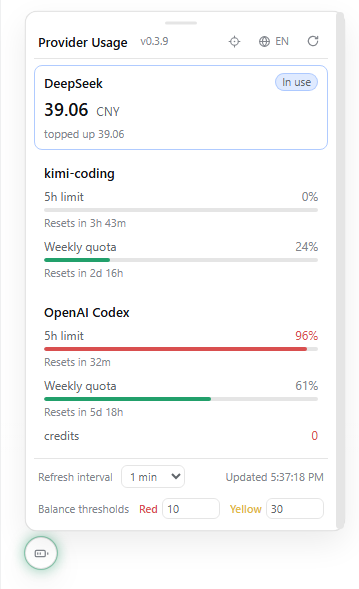
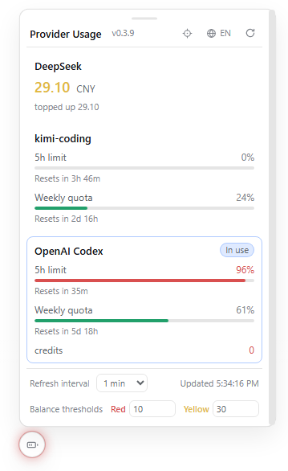

<p align="right">
  <strong>English</strong> · <a href="./README_ZH.md">简体中文</a>
</p>

<p align="center">
  <a href="https://www.npmjs.com/package/dsh-provider-usage"></a>
  <a href="./LICENSE"></a>
  
</p>

# dsh-provider-usage

**Every provider's balance, one glance away.** A [DeepSeek Harness](https://github.com/deepseek-ai/deepseek-harness) plugin that floats a small draggable usage ball over the Web GUI **and the Desktop app** — no more logging into each provider console to check whether you are about to run out of credit mid-session. One package supports both surfaces: the desktop window renders the same Web GUI, so the same install works everywhere.

## Features

- **Auto-detection** — enumerates the provider routes registered in the current profile (`ctx.llm`); zero configuration for well-known routes.
- **Per-kind wire adapters** — routes with no public balance/usage API (Google, Mistral, Groq, Bedrock, Azure, Qwen Token Plan, …) are listed as `unsupported` instead of being silently dropped:

  | kind | routes | query | shows |
  |---|---|---|---|
  | `deepseek` | `deepseek-official`, `deepseek` | `GET {baseURL}/user/balance` | total / granted / topped-up balance |
  | `deepseek-account` | `deepseek-account` (dsh ≥ 0.1.7) | `GET {platformOrigin}/api/v0/users/get_user_summary` | account wallet balance (recharge + bonus merged; **reads the harness's built-in DeepSeek Account sign-in**, zero config). The harness composes this route unconditionally, so the card is **omitted while no sign-in is stored** — it appears on the next poll after you sign in |
  | `moonshot` | `moonshotai-cn`, `moonshotai` | `GET {baseURL}/users/me/balance` | available / voucher / cash balance |
  | `kimi-coding` | `kimi-coding` | `GET {baseURL}/v1/usages` | 5h / weekly / monthly usage windows + reset countdown. A lapsed membership is reported as **“no active plan”** instead of a blank card — the endpoint answers `{}` (HTTP 200) once the plan ends |
  | `commandcode` | `commandcode` | `GET {origin}/alpha/billing/credits` | 5h / weekly windows + monthly credits (usage summary is best-effort) |
  | `openrouter` | `openrouter` | `GET {origin}/api/v1/credits` | credits used / total |
  | `github-copilot` | `github-copilot` | `GET api.github.com/copilot_internal/user` | plan usage snapshots (paid) or monthly usage (free) |
  | `openai-codex` | `openai-codex` | `GET {baseURL}/wham/usage` | ChatGPT subscription 5h / weekly windows + credits + spend control (**OAuth login**, not an API key — see the [setup guide](docs/provider-codex.md)) |
  | `openai` | `openai` | `GET {origin}/v1/organization/costs` | current-month spend (**admin key required**; a regular key fails with 403) |
  | `anthropic` | `anthropic` | `GET {baseURL}/v1/organizations/cost_report` | current-month spend (**admin key required**, `x-api-key` auth) |
  | `minimax` | `minimax`, `minimax-cn` | `GET {origin}/v1/api/openplatform/coding_plan/remains` | Coding Plan 5h / weekly remaining % |
  | `zai` | `zai`, `zai-coding-cn` | `GET {origin}/api/monitor/usage/quota/limit` | GLM Coding Plan windows, `TOKENS_LIMIT` or `CREDIT_LIMIT` entries (raw key in `Authorization`, no Bearer) |
  | `opencode` | `opencode`, `opencode-go` | `GET {baseURL}/usage` | Zen Go rolling / weekly / monthly windows |
  | `vercel-ai-gateway` | `vercel-ai-gateway` | `GET {baseURL}/v1/credits` | team credit balance |
  | `xai` | `xai` | `GET {baseURL}/billing/credits` | prepaid balance (USD) |
  | `volcengine-ark-agent` | `ark-agent-plan`, `ark-agent-plan-cn` | `POST open.volcengineapi.com GetAFPUsage` | Volcengine Ark Agent Plan 5h / weekly / monthly windows (**needs IAM AK/SK signing**, not the inference key — see the [setup guide](docs/provider-ark.md)) |
  | `volcengine-ark-coding` | `ark-coding-plan`, `ark-coding-plan-cn` | `POST open.volcengineapi.com GetCodingPlanUsage` | Volcengine Ark Coding Plan session / weekly / monthly windows (same AK/SK pair) |
- **Credentials stay safe** — API keys are resolved per request through the harness credentials service (environment variables / `~/.dsh/.credentials.yaml`); never cached, never written to disk. For OAuth providers (OpenAI Codex) the plugin reads the grant record the sign-in flow stored, and refreshes it transparently when it is about to expire. The Volcengine Ark plan routes are the one case where a query needs more than the route's own key: plan usage is a *signed control-plane* call, so those two kinds read an IAM AK/SK pair instead (see the [setup guide](docs/provider-ark.md)).
- **Floating ball widget** — a draggable floating ball opens the usage panel:
  - Drop it anywhere in the viewport (position persisted); it docks by default at the bottom-left of the chat area with equal margins, and the panel-header home button sends it back.
  - The panel scrolls when the provider list grows past its height; its top edge is draggable to resize it taller or shorter (height persisted).
  - The halo encodes the health of the provider **in use** — the focused session's own selection (its composer's model seat), tracked live on the client, so switching sessions re-highlights that session's provider immediately without re-selecting a model. Green: all good; amber: a usage window under 30% left or a balance below the yellow threshold; red: query failure / missing key / usage ≥90% / balance below the red threshold. Idle providers running low do not color the ball — the panel marks the in-use provider and still lists every provider's numbers.
- **Version badge** — the panel header shows the running plugin version next to the title, so it is obvious which release is loaded.
- **Bilingual panel** — built-in Chinese/English UI; follows the harness language by default, with a one-click toggle in the panel header (persisted in localStorage).
- **Configurable refresh** — adjustable in the panel (15s–30min, persisted in localStorage); the default comes from the plugin config.
- **Configurable balance thresholds** — balance-type providers (DeepSeek, Moonshot, Vercel AI Gateway, xAI) and the `credits` rows of usage-type providers (OpenRouter, OpenAI Codex) turn red below the red threshold and yellow below the yellow threshold, compared in the balance's own currency (defaults: red < 10, yellow < 30, whether CNY or USD). Both values are editable directly in the panel footer (persisted in localStorage); the defaults come from the plugin config. For providers reporting both a subscription plan and credits (e.g. OpenAI Codex), the two are OR'ed: the ball stays green while either one has enough left, and when both are running low the lighter warning wins (the plan is normally consumed before credits).
- **Manual providers** — add arbitrary gateways (e.g. a self-hosted DeepSeek-compatible endpoint) via config.

## Screenshots

The floating ball (bottom-left, with the green healthy halo) and the open usage panel:

| DeepSeek in use | OpenAI Codex in use |
| --- | --- |
|  |  |

## Provider setup guides

Most providers need nothing beyond their API key. Two families need one extra setup step:

- **OpenAI Codex** — a ChatGPT-subscription provider authenticated by an OAuth grant in the harness credential store (no API key field). Route setup, token refresh/rotation behavior, and the intermittent "servers overloaded" retry policy: [docs/provider-codex.md](docs/provider-codex.md).
- **Volcengine Ark Agent Plan / Coding Plan** — plan quota lives on Volcengine's control plane and needs a signed IAM AK/SK pair in addition to the inference key. Route and credential setup: [docs/provider-ark.md](docs/provider-ark.md).

## Install or upgrade

> [!NOTE]
> Requires an existing [DeepSeek Harness](https://github.com/deepseek-ai/deepseek-harness) installation. Install and upgrade are the same command on every surface.

### Web GUI

```sh
dsh plugin --profile web add dsh-provider-usage@latest
```

After changing the plugin set, restart `dsh web` and refresh the page (later code-only changes need just a rebuild + re-add + refresh). If the release you want was published very recently, your profile's supply-chain cooldown (`minimumReleaseAge`) may silently keep the older version — pin the exact version instead (`dsh plugin --profile web add dsh-provider-usage@0.3.10`) and dsh will exempt it automatically. The version badge in the panel header confirms which release is actually loaded.

### Desktop app

The same package also runs in the Desktop app — the desktop window renders the same Web GUI, so **no separate plugin or build is needed**. The desktop app owns its own profile (`~/.dsh/profiles/desktop`), so install the plugin there once:

1. In the desktop app, open **Settings → Plugins** → **Add plugin** → **Install a third-party plugin** ([screenshot](docs/desktop-install-menu-en.png)).
2. Enter `dsh-provider-usage` and click **Install** ([screenshot](docs/desktop-install-dialog-en.png)).
3. Click **Enable now** ([screenshot](docs/desktop-install-enable-en.png)).

The floating ball appears in the desktop window immediately ([screenshot](docs/desktop-panel-en.png)). Panel preferences (ball position, refresh interval, thresholds) persist per origin, so the desktop app and the Web GUI keep their own layouts independently.

To upgrade on the Desktop app, uninstall then reinstall from the same Plugins page (the desktop dialog asks for this order) and reload the window.

CLI alternative: fully quit the desktop app (including the tray), then use the CLI carried by the desktop installation — `<install-dir>\resources\runtime\cli\bin\dsh.cmd plugin --profile desktop add dsh-provider-usage@latest`. The npm-installed `dsh` refuses the reserved `desktop` profile (`profile "desktop" is managed exclusively by the Electron application`).

### Build from source

```sh
git clone https://github.com/lizhouai/dsh-provider-usage.git
cd dsh-provider-usage
pnpm install
pnpm build
pnpm pack   # produces dsh-provider-usage-<version>.tgz
dsh plugin --profile web add ./dsh-provider-usage-<version>.tgz   # desktop: --profile desktop (via the desktop-carried CLI)
```

Install the **tarball**, not the repo directory: `dsh plugin --profile web add .` links the repo, whose own `node_modules` then shadows the harness's shared `@deepseek-ai/cordis` instance and the host half never registers (RPC 404). The link form is still handy for client-only UI iteration — the browser bundle is self-contained, so a rebuild + page refresh picks it up — but switch to the tarball (or the npm release) whenever you need the host half. If pnpm fails with `EPERM ... symlink` while replacing a linked install, delete the stale `node_modules/dsh-provider-usage` junction in the profile directory and retry.

## Host compatibility

The host packages this plugin imports (`@deepseek-ai/dsh-credentials`, `-settings`, `-typert-protocol`, `-launch-environment`) resolve to the running harness's own copies, and dsh's peer gate compares the declared ranges against the runtime version. This plugin therefore declares an **open lower bound** (`>=0.1.2-alpha.3`), which every runtime passes — a narrow `^`-range would be skipped as `skipping profile bundle` on each dsh minor release. Install through `dsh plugin … add` (pnpm-based): plain `npm install` answers `ERESOLVE`, because standard semver never matches a prerelease against an open range.

If a dsh release renames a seam the plugin reads, the plugin degrades instead of breaking — the harness log names what is missing (`provider-usage: this dsh provides no …`, see `src/host-seams.ts`), and the [`compat`](.github/workflows/compat.yml) workflow replays the gate against the `latest` and `next` release lines daily, so drift surfaces in CI rather than in your panel.

## Configuration

Defaults work out of the box: the plugin auto-detects every provider route of the active profile. A trusted profile can tune behavior in its bundle patch — `~/.dsh/profiles/web/cordis.patch.yml` (desktop: `~/.dsh/profiles/desktop/cordis.patch.yml`) — **override the bundle's row by id** (the package's own bundle patch already inserts it; a second `insert` of the same id fails the boot with `duplicate loader entry id`):

```yaml
- id: provider-usage
  name: dsh-provider-usage
  config:
    refreshSeconds: 60          # suggested panel refresh interval (5–86400)
    balanceRedThreshold: 10     # balance below this turns red (per the balance's own currency)
    balanceYellowThreshold: 30  # balance below this turns yellow (per the balance's own currency)
    autoDetect: true            # enumerate provider routes from the llm registry
    queryTimeoutMs: 20000       # per-attempt query timeout; each retry gets a fresh timeout
    queryRetries: 2             # retries for transient errors (timeout/network/HTTP 408/425/429/5xx)
    queryRetryDelayMs: 2000     # base retry delay, doubled per attempt, capped at 10s
    providers: []               # manual specs; an id matching a detected route overrides it
```

| Field | Type | Default | Description |
| --- | --- | --- | --- |
| `refreshSeconds` | number | `60` | Suggested widget refresh interval in seconds (5–86400) |
| `balanceRedThreshold` | number | `10` | Balance below this amount turns red, compared in the balance's own currency |
| `balanceYellowThreshold` | number | `30` | Balance below this amount turns yellow, compared in the balance's own currency |
| `autoDetect` | boolean | `true` | Enumerate live provider routes from the llm registry |
| `queryTimeoutMs` | number | `20000` | Per-attempt query timeout (1000–120000); each retry gets a fresh timeout |
| `queryRetries` | number | `2` | Retries for transient errors — timeout / network / HTTP 408, 425, 429, 5xx (0–10); permanent 4xx errors fail immediately |
| `queryRetryDelayMs` | number | `2000` | Base delay between retries (100–60000), doubled per attempt, capped at 10s |
| `providers` | array | `[]` | Manual provider specs: `{id, kind, baseURL, apiKeyEnv, displayName?, enabled?}`; `kind` is one of the adapter table above |

The same fields can be hot-updated under the `provider-usage:` namespace in `~/.dsh/settings.yaml`.

### Adding a manual provider

```yaml
config:
  providers:
    - id: my-deepseek-gateway
      kind: deepseek
      baseURL: https://my-gateway.example.com
      apiKeyEnv: MY_GATEWAY_KEY
      displayName: My Gateway
```

## How it works

- **Host half** (`src/index.ts`): `UsageService extends TypertRemoteService` exposes `usage/list` via the `Remote('list')` marker, applied without decorator syntax (SRC mode, no codegen). Config is declared with schemastery, and the settings provider's `installSection` enables hot updates from the settings document.
- **Client half** (`src/client/`): a `window.__ModuleLoader__.load({id, factory})` bundle (built by tsdown) mounts through the `sidebar.footer.action` slot (used purely as a mount point — the trigger itself is a floating ball portaled to `document.body`) and polls `usage/list` through `ctx.connection.rpc.call('/api', 'usage/list', {args:{}})` on its own interval. The service stays stateless — every poll fetches live values.

## License

[MIT](./LICENSE)
