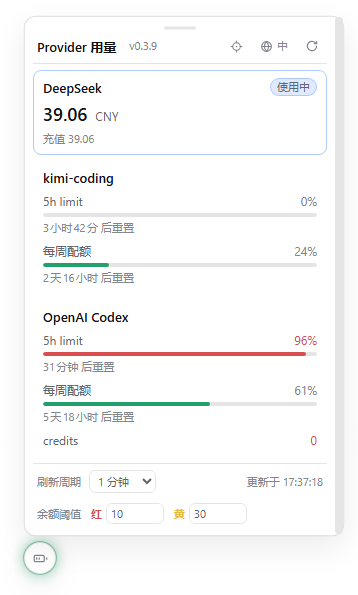
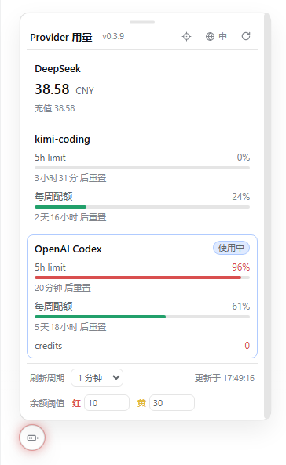

<p align="right">
  <a href="./README.md">English</a> · <strong>简体中文</strong>
</p>

<p align="center">
  <a href="https://www.npmjs.com/package/dsh-provider-usage"></a>
  <a href="./LICENSE"></a>
  
</p>

# dsh-provider-usage

[DeepSeek Harness](https://github.com/deepseek-ai/deepseek-harness) 插件：在 Web GUI **与桌面端（Desktop App）**悬浮一个可任意拖动的用量球，实时查看所有已配置 LLM provider 的账户余额与用量——不用再逐个登录 provider 控制台确认。同一个包同时支持两种形态：桌面端窗口渲染的就是同一套 Web GUI，一次发布两端通用。

## 功能

- **自动探测** —— 自动枚举当前 profile 中已注册的 provider 路由（`ctx.llm`），常见路由零配置。
- **按 provider 类型查询额度** —— 没有公开余额/用量接口的路由（Google、Mistral、Groq、Bedrock、Azure、Qwen Token Plan 等）会在面板中标注为「不支持」，而不是被静默忽略：

  | kind | 路由 | 查询接口 | 展示内容 |
  |---|---|---|---|
  | `deepseek` | `deepseek-official`、`deepseek` | `GET {baseURL}/user/balance` | 余额（含赠送/充值明细） |
  | `deepseek-account` | `deepseek-account`（dsh ≥ 0.1.7） | `GET {platformOrigin}/api/v0/users/get_user_summary` | 账号钱包余额（充值 + 赠送合并展示，**读取 harness 内置 DeepSeek 账号登录**，无需配置）。该路由由 harness 无条件组合，因此**未登录时不显示该卡片**，登录后下一次轮询自动出现 |
  | `moonshot` | `moonshotai-cn`、`moonshotai` | `GET {baseURL}/users/me/balance` | 可用/代金券/现金余额 |
  | `kimi-coding` | `kimi-coding` | `GET {baseURL}/v1/usages` | 5h / 每周 / 每月用量窗口，含重置倒计时。会员到期后接口返回 `{}`（HTTP 200），卡片会明确显示**「无生效中的套餐」**，而不是留一张空白卡片 |
  | `commandcode` | `commandcode` | `GET {origin}/alpha/billing/credits` | 5h/周窗口 + 月度积分（用量摘要尽力而为） |
  | `openrouter` | `openrouter` | `GET {origin}/api/v1/credits` | credit 已用/总额 |
  | `github-copilot` | `github-copilot` | `GET api.github.com/copilot_internal/user` | 付费档用量快照 / 免费档月度用量 |
  | `openai-codex` | `openai-codex` | `GET {baseURL}/wham/usage` | ChatGPT 订阅 5h/周窗口 + credits + spend control（**OAuth 登录**，非 API key，见 [配置指南](docs/provider-codex.zh.md)） |
  | `openai` | `openai` | `GET {origin}/v1/organization/costs` | 当月花费（**需 Admin key**，普通 key 会 403） |
  | `anthropic` | `anthropic` | `GET {baseURL}/v1/organizations/cost_report` | 当月花费（**需 Admin key**，`x-api-key` 头） |
  | `minimax` | `minimax`、`minimax-cn` | `GET {origin}/v1/api/openplatform/coding_plan/remains` | Coding Plan 5h/周剩余百分比 |
  | `zai` | `zai`、`zai-coding-cn` | `GET {origin}/api/monitor/usage/quota/limit` | GLM Coding Plan 窗口，`TOKENS_LIMIT` 或 `CREDIT_LIMIT` 条目（`Authorization` 直接放 key，无 Bearer） |
  | `opencode` | `opencode`、`opencode-go` | `GET {baseURL}/usage` | Zen Go 滚动/周/月窗口 |
  | `vercel-ai-gateway` | `vercel-ai-gateway` | `GET {baseURL}/v1/credits` | 团队 credit 余额 |
  | `xai` | `xai` | `GET {baseURL}/billing/credits` | 预付余额（USD） |
  | `volcengine-ark-agent` | `ark-agent-plan`、`ark-agent-plan-cn` | `POST open.volcengineapi.com GetAFPUsage` | 火山方舟 Agent Plan 5h/周/月窗口（**需 IAM AK/SK 签名**，非推理 key，见 [配置指南](docs/provider-ark.zh.md)） |
  | `volcengine-ark-coding` | `ark-coding-plan`、`ark-coding-plan-cn` | `POST open.volcengineapi.com GetCodingPlanUsage` | 火山方舟 Coding Plan session/周/月窗口（同一对 AK/SK） |
- **密钥安全** —— 通过 harness 凭据服务按次解析（环境变量 / `~/.dsh/.credentials.yaml`），不缓存、不落地。对 OAuth 类 Provider（OpenAI Codex）则直接读取登录流程存入的授权记录，并在令牌临近过期时自动刷新。火山方舟套餐路由是唯一「查询需要路由自身 key 之外凭证」的情形：套餐额度走**签名控制面**调用，因此这两类适配器改读一对 IAM AK/SK（见 [配置指南](docs/provider-ark.zh.md)）。
- **悬浮球入口** —— 可任意拖动的悬浮球，点击弹出用量面板：
  - 可拖到视口任意位置（位置持久化）；默认停靠在主对话区域左下角（左边距 = 底边距），面板头部的归位按钮一键回到默认位置。
  - Provider 列表超过面板高度时自动滚动；面板**顶部边缘可拖拽**调整高度（localStorage 持久化）。
  - 球体光晕表达**当前正在使用**的 Provider——即**当前聚焦 session 自己的模型选择**（composer 模型座同源，客户端实时跟踪），切换 session 后无需重新选择模型，面板立即把「使用中」标记切到该 session 的 Provider。绿色正常；黄色用量窗口剩余不足 30% 或余额低于黄阈值；红色查询失败/缺密钥/用量 ≥90% 或余额低于红阈值。闲置 Provider 余量不足不影响球体颜色——面板会标注「使用中」的 Provider，并照常列出所有 Provider 的用量明细。
- **版本徽章** —— 面板标题旁显示当前运行的插件版本，一眼确认加载的是哪个发布版。
- **中英双语** —— 面板内置中英文界面，默认跟随 harness 系统语言，标题栏按钮一键切换（localStorage 持久化）。
- **刷新周期可调** —— 面板内调整（15s–30min，localStorage 持久化），默认值由插件配置提供。
- **余额阈值可调** —— 余额型 Provider（DeepSeek、Moonshot、Vercel AI Gateway、xAI）以及 usage 型 Provider 中的 `credits` 行（OpenRouter、OpenAI Codex）会按余额数值变色：低于红阈值变红、低于黄阈值变黄（按查询到的币种本身比较，默认红 < 10、黄 < 30，人民币/美元一致）。两个阈值可直接在面板底部修改（localStorage 持久化），默认值由插件配置提供。同一 Provider 同时上报套餐与 credits 时二者取「或」关系：只要其中一个余量充足球体即显示绿色，两者都偏低时取较轻的警示（套餐通常先用完、credits 兜底）。
- **手动 provider** —— 可通过配置添加任意网关（如自建 DeepSeek 兼容端点）。

## 截图

悬浮球（左下角，绿色光晕表示全部正常）与打开的用量面板：

| DeepSeek 使用中 | OpenAI Codex 使用中 |
| --- | --- |
|  |  |

## Provider 配置指南

绝大多数 provider 只需 API key 即可。有两类需要多做一步配置：

- **OpenAI Codex** —— ChatGPT 订阅制 Provider，通过 harness 凭据库中的 OAuth 授权记录认证（没有 API key 可填）。路由配置、令牌刷新/轮换行为、间歇性 "servers overloaded" 的重试策略见 [docs/provider-codex.zh.md](docs/provider-codex.zh.md)。
- **火山方舟 Agent Plan / Coding Plan** —— 套餐额度在火山控制面，除推理 key 外还需一对 IAM AK/SK 做签名。路由与凭证配置见 [docs/provider-ark.zh.md](docs/provider-ark.zh.md)。

## 安装或升级

> [!NOTE]
> 需要先安装 [DeepSeek Harness](https://github.com/deepseek-ai/deepseek-harness)。所有形态下安装与升级都是同一条命令。

### Web GUI

```sh
dsh plugin --profile web add dsh-provider-usage@latest
```

插件集合变化后需重启 `dsh web` 并刷新页面（之后的纯代码改动只需重新 build + 重新 add + 刷新页面）。如果目标版本刚发布不久，profile 的供应链冷静期（`minimumReleaseAge`）可能会静默停留在旧版——这时指定精确版本号（如 `dsh plugin --profile web add dsh-provider-usage@0.3.10`），dsh 会自动豁免该版本。面板标题旁的版本徽章可以确认实际加载的版本。

### 桌面端（Desktop App）

同一个包同样支持桌面端——桌面端窗口渲染的就是同一套 Web GUI，**无需单独的插件或构建**。桌面端独占自己的 profile（`~/.dsh/profiles/desktop`），需在桌面端内单独安装一次：

1. 桌面端内打开 **设置 → 插件** → **添加插件** → **安装第三方插件**（[截图](docs/desktop-install-menu-zh.png)）；
2. 输入 `dsh-provider-usage`，点击 **安装**（[截图](docs/desktop-install-dialog-zh.png)）；
3. 点击 **立即启用**（[截图](docs/desktop-install-enable-zh.png)）。

悬浮球随即出现在桌面端窗口中（[效果截图](docs/desktop-panel-zh.png)）。面板偏好（球位置、刷新周期、阈值）按 origin 分别持久化，桌面端与 Web GUI 各自记忆、互不影响。

桌面端升级：在同一个插件页面先卸载再安装新版（安装弹窗要求这个顺序），重新加载窗口即可。

CLI 方式：完全退出桌面端（含托盘）后，使用桌面安装目录自带的 CLI——`resources\runtime\cli\bin\dsh.cmd plugin --profile desktop add dsh-provider-usage@latest`。npm 版 `dsh` 会拒绝 desktop profile（报 `profile "desktop" is managed exclusively by the Electron application`）。

### 从源码构建

```sh
git clone https://github.com/lizhouai/dsh-provider-usage.git
cd dsh-provider-usage
pnpm install
pnpm build
pnpm pack   # 产出 dsh-provider-usage-<version>.tgz
dsh plugin --profile web add ./dsh-provider-usage-<version>.tgz   # 桌面端：--profile desktop（用桌面自带 CLI）
```

注意要安装 **tarball** 而不是仓库目录：`dsh plugin --profile web add .` 会链接整个仓库，仓库自带 `node_modules` 里的 `@deepseek-ai/cordis` 会遮蔽 harness 的共享实例，导致 host 半注册不上（RPC 404）。link 方式仍适合纯 UI 迭代（浏览器 bundle 自包含，重新 build + 刷新页面即生效），但需要 host 半时请切换到 tarball 或 npm 正式版。若替换 link 安装时 pnpm 报 `EPERM ... symlink`，手动删除 profile 目录下残留的 `node_modules/dsh-provider-usage` 联结后重试即可。

## 宿主兼容性

本插件导入的宿主包（`@deepseek-ai/dsh-credentials`、`-settings`、`-typert-protocol`、`-launch-environment`）会解析到运行中 harness 自己的那一份，dsh 的 peer 闸门会拿声明范围与运行时版本比对。因此本插件声明**开放下界** `>=0.1.2-alpha.3`：任何运行时（含预发布）都能通过——窄的 `^` 范围会在 dsh 每次 minor 升级时被 `skipping profile bundle` 跳过。请通过 `dsh plugin … add`（走 pnpm）安装：直接用 `npm install` 会报 `ERESOLVE`，因为标准 semver 不会用开放范围匹配预发布版本。

如果某个 dsh 版本改掉了插件读取的接缝，插件会降级而不是报错——harness 日志会指明缺什么（`provider-usage: this dsh provides no …`，见 `src/host-seams.ts`），[`compat`](.github/workflows/compat.yml) 工作流每天对 `latest` 与 `next` 两条发布线回放闸门，漂移会在 CI 暴露而不是在你的面板里。

## 配置说明

默认开箱即用：自动探测当前 profile 的所有 provider 路由。也可以在 profile 的 bundle patch 中调整——`~/.dsh/profiles/web/cordis.patch.yml`（桌面端：`~/.dsh/profiles/desktop/cordis.patch.yml`）——**按 id 覆盖**包内 bundle 已挂载的行（包自带的 bundle patch 已经 insert 过该行，再 insert 一次相同 id 会导致启动报 `duplicate loader entry id`）：

```yaml
- id: provider-usage
  name: dsh-provider-usage
  config:
    refreshSeconds: 60          # 面板默认刷新周期（秒）
    balanceRedThreshold: 10     # 余额低于该值变红（按余额自身币种比较）
    balanceYellowThreshold: 30  # 余额低于该值变黄（按余额自身币种比较）
    autoDetect: true            # 自动枚举 llm 注册表中的 provider
    queryTimeoutMs: 20000       # 单次查询超时（毫秒），每次重试独立计时
    queryRetries: 2             # 瞬时错误（超时/网络/HTTP 408/425/429/5xx）重试次数
    queryRetryDelayMs: 2000     # 重试基础延迟（毫秒），逐次翻倍，封顶 10 秒
    providers: []               # 手动补充/覆盖 provider（id 相同则覆盖自动探测结果）
```

| 字段 | 类型 | 默认 | 说明 |
| --- | --- | --- | --- |
| `refreshSeconds` | number | `60` | 面板建议刷新周期（秒），5–86400 |
| `balanceRedThreshold` | number | `10` | 余额低于该值变红，按余额自身币种比较 |
| `balanceYellowThreshold` | number | `30` | 余额低于该值变黄，按余额自身币种比较 |
| `autoDetect` | boolean | `true` | 从 llm 注册表自动枚举 provider |
| `queryTimeoutMs` | number | `20000` | 单次查询超时（毫秒），1000–120000，每次重试独立计时 |
| `queryRetries` | number | `2` | 瞬时错误（超时/网络/HTTP 408/425/429/5xx）的重试次数，0–10；4xx 永久错误不重试 |
| `queryRetryDelayMs` | number | `2000` | 重试基础延迟（毫秒），100–60000，指数翻倍，封顶 10 秒 |
| `providers` | array | `[]` | 手动 provider 规格：`{id, kind, baseURL, apiKeyEnv, displayName?, enabled?}`，`kind` 取上表中的任一适配器 |

也可以在 `~/.dsh/settings.yaml` 中通过 `provider-usage:` 命名空间热更新同样字段。

### 手动添加一个 provider 示例

```yaml
config:
  providers:
    - id: my-deepseek-gateway
      kind: deepseek
      baseURL: https://my-gateway.example.com
      apiKeyEnv: MY_GATEWAY_KEY
      displayName: 自建网关
```

## 架构

- **Host 半**（`src/index.ts`）：`UsageService extends TypertRemoteService`，通过 `Remote('list')` 标记（以非装饰器方式应用）暴露 `usage/list`（SRC 模式，无需代码生成）；`Config` 用 schemastery 声明，通过 settings provider 的 `installSection` 支持 settings 热更新。
- **Client 半**（`src/client/`）：`window.__ModuleLoader__.load({id, factory})` 格式 bundle（tsdown 构建），通过 `sidebar.footer.action` slot 挂载（仅作为挂载点——触发器本体是 portal 到 `document.body` 的悬浮球），通过 `ctx.connection.rpc.call('/api', 'usage/list', {args:{}})` 轮询。服务本身无状态——每次轮询都取实时值。

## 许可证

[MIT](./LICENSE)
